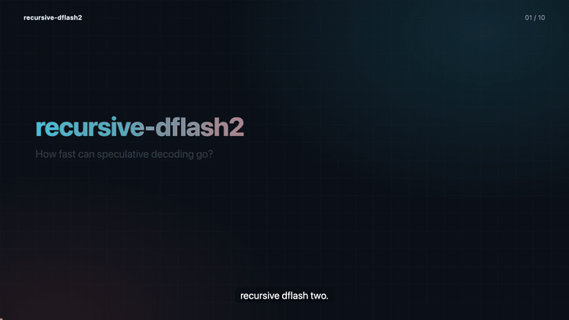
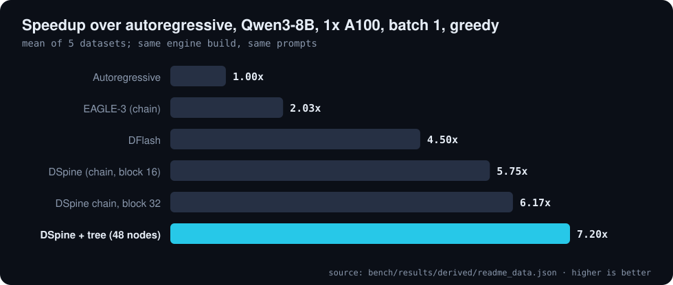
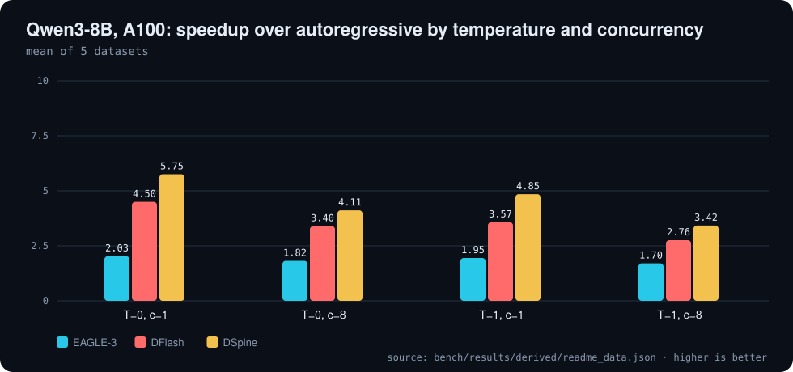
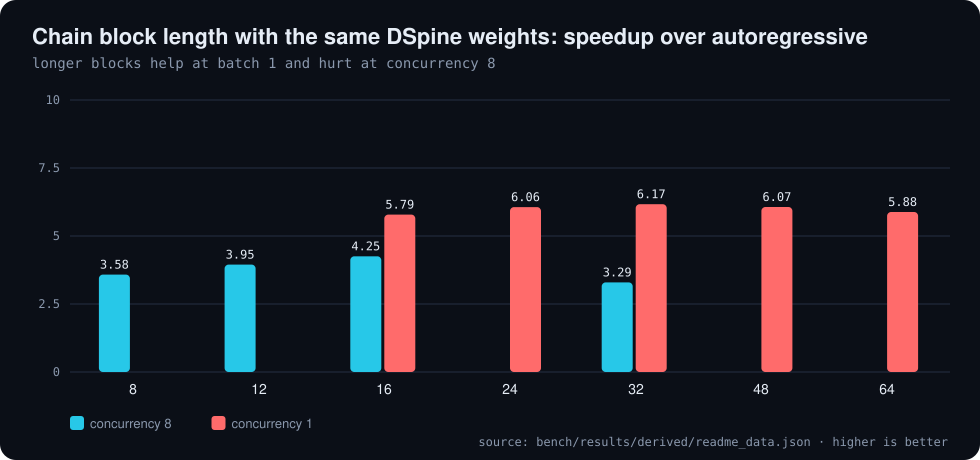
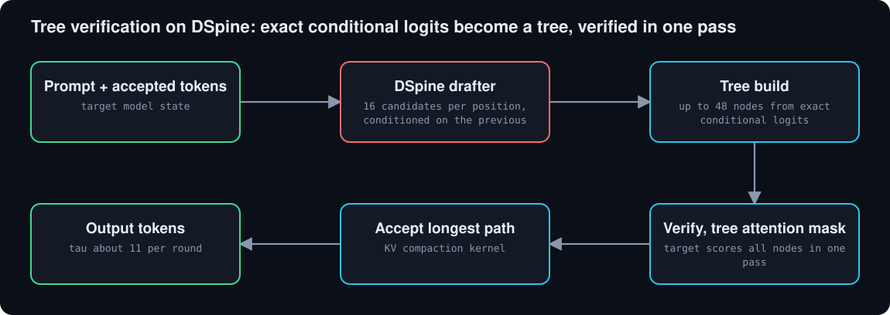

<div align="center">



# 🚀 recursive-dflash2

**How fast can speculative decoding go, and does stacking drafters help? DFlash, DFlash2, DSpine and EAGLE-3 head to head, plus tree verification**

[](LICENSE) [](https://github.com/Bobliuuu/recursive-dflash2/releases/tag/v0.1.0) [](https://huggingface.co/datasets/Bobliu/recursive-dflash2)    

[🎬 Video](#video) · [📊 Results](#results) · [🌳 Tree verification](#tree) · [🧩 How it works](#how-it-works) · [🔁 Reproduce](#reproduce) · [⚠️ Reading the numbers](#caveats) · [🗺️ Repo map](#repo-map)

</div>

---

**Explainer video (voice-over and subtitles): drafters, tree verification, the numbers, and how to read them**

[](video/recursive_dflash2_explainer.mp4)

<a id="video"></a>
Speculative decoding drafts several tokens cheaply and lets the big model verify them in one pass. This repo benchmarks the current drafters
(**DFlash, DFlash2, DSpine, EAGLE-3**) on one engine build (SGLang 0.5.22) with a frozen prompt set and raw per-request JSON in `bench/results/`,
then adds a **tree-verification upgrade** for DSpine that needs no retraining.

<a id="results"></a>

## 📊 Results

One engine build (SGLang 0.5.22), a frozen prompt set, raw per-request JSON in `bench/results/`. Numbers below are recomputed from those files by `tools/readme_data.py`.

| DSpine + tree | DSpine chain | DFlash | EAGLE-3 | Tree gain |
|:---:|:---:|:---:|:---:|:---:|
| **7.20x** | **5.75x** | **4.50x** | **2.03x** | **25%** |

**Qwen3-8B, 1x A100-80GB, thinking off: speedup over autoregressive (mean over GSM8K / MATH-500 / HumanEval / MBPP / MT-Bench)**

| T | concurrency | EAGLE-3 (chain) | DFlash | DSpine |
| ---: | ---: | ---: | ---: | ---: |
| 0 | 1 | 2.03x | 4.50x | 5.75x |
| 0 | 8 | 1.82x | 3.40x | 4.11x |
| 1 | 1 | 1.95x | 3.57x | 4.85x |
| 1 | 8 | 1.70x | 2.76x | 3.42x |

<sub>Source: `bench/results/derived/readme_data.json`</sub>

<p align="center"></p>

<p align="center"></p>

<p align="center"></p>

DSpine is the best single drafter: it beats DFlash on Qwen3-8B at every temperature and concurrency we ran, and the official DFlash2 on Qwen3.8-27B (no DFlash checkpoint exists for that model).
Published acceptance numbers reproduce with a catch: our runs match the DSpine README, not the paper's smaller retrained-baseline table, so always read the protocol next to the number.

<a id="tree"></a>

## 🌳 Tree verification

The same DSpine weights, verified as a 48-node tree instead of a chain. DSpine already scores 16 candidates per position conditioned on the previous position, so the tree comes from exact conditional logits each round; verify is nearly free on an A100 (11.05 ms at 16 tokens, 11.91 ms at 48 per [docs/phase4-tree-overhead.md](docs/phase4-tree-overhead.md)).

### Qwen3.8-27B (1x H100-80GB, thinking on, 64 prompts per concurrency-8 cell)

| Method | c=1 T=0 | c=1 T=1 | c=8 T=0 | c=8 T=1 |
|---|---|---|---|---|
| DSpine + tuned SPS | 4.52x | 3.92x | 3.30x | 2.75x |
| DFlash2 (official, block 8) | 3.99x | 3.63x | 2.98x | 2.72x |
| DSpark (community, block 7) | 3.57x | 3.30x | 2.83x | n/a |
| MTP (built-in head) | 2.42x | 2.15x | 2.20x | n/a |

Most of DSpine's edge over DFlash2 is block length: at matched verify width 8 it is slightly behind. Details and caveats: [docs/phase1-qwen3.8-27b.md](docs/phase1-qwen3.8-27b.md).


Other hardware and sampling, same tree:

| Setup | Result | Doc |
|---|---|---|
| Qwen3-8B, H100, 64-node tree | 6.49x AR, +27% over the stock chain | [phase4-h100-27b.md](docs/phase4-h100-27b.md) |
| Qwen3-8B, DGX Spark (GB10), 32-node tree | 7.80x AR (bf16); 157 tok/s with an NVFP4 target | [phase4-gb10-spark.md](docs/phase4-gb10-spark.md) |
| Qwen3-8B, A100, **T=1** lossless sampled tree | 5.43x AR, +12% over the chain | [phase4-t1-tree.md](docs/phase4-t1-tree.md) |
| Qwen3.8-27B hybrid, H100 | 4.95x AR, +5.7% over the chain | [phase4-h100-27b.md](docs/phase4-h100-27b.md) |

**Tree verification (Qwen3-8B, A100, batch 1, T=0)**

| Config | Acceptance length | tok/s | x AR |
| :--- | ---: | ---: | ---: |
| DSpine b16 chain | 7.99 | 521 | 5.75x |
| DSpine b32 chain (same weights) | 9.03 | 558 | 6.17x |
| **DSpine tree, 48 nodes** | **11.29** | **652** | **7.20x** |

<sub>Source: `bench/results/derived/readme_data.json`</sub>

<p align="center"></p>

<a id="how-it-works"></a>

## 🧩 How it works

The tree path, tree-attention mask, accept and KV-compaction CUDA kernels and the SGLang patches live in `bench/p2tree/` and `bench/p4tree/`. Write-ups: [tree](docs/phase2-findings.md), [fast path](docs/phase4-tree-overhead.md).

### What we tried

We also tested longer-block training and recursive second drafting passes (on pass-1 tokens, and on pass-1 features scored as a tree) on top of DSpine; none beat tree verification (these were short warm-start fine-tunes of the official weights, not from-scratch training; a from-scratch run is in progress), details in [docs/phase3-findings.md](docs/phase3-findings.md) and [docs/phase6-recursive-tree-pass2.md](docs/phase6-recursive-tree-pass2.md).

<p align="center"></p>

<a id="reproduce"></a>

## 🔁 Reproduce it

Needs one NVIDIA GPU (A100-80GB tested; H100 and GB10 also run), CUDA 13 toolchain (installed by the script) and about 60 GB of disk. The stack is pinned: SGLang 0.5.22, torch 2.14.1+cu130, flashinfer 0.7.1, [Tencent/DSpine](https://github.com/Tencent/DSpine) for the drafter weights.

```bash
# 1. fresh box: clone to /workspace/recursive-dflash2, then install the stack, download Qwen3-8B + DSpine-b16,
#    and build the block-16/32/48 draft dirs (same weights, longer block)
git clone https://github.com/Bobliuuu/recursive-dflash2 /workspace/recursive-dflash2
bash /workspace/recursive-dflash2/bench/setup_box.sh

# 2. baseline: stock DSpine chain, then the benchmark cell (GSM8K, greedy, batch 1)
bash bench/p4_serve.sh chain
python bench/run_cell.py --method dspine_chain --dataset gsm8k --temp 0 --conc 1 --n 40 --block 16 --out /tmp/chain_gsm8k.json

# 3. the upgrade: same weights, 48-node tree verification (patches SGLang in place; --revert undoes it)
RDF2_TABLE=factored FIMASK=skip bash bench/p4_serve.sh fast 48 31
python bench/run_cell.py --method dspine_tree --dataset gsm8k --temp 0 --conc 1 --n 40 --block 48 --out /tmp/tree_gsm8k.json
```

Each cell prints acceptance length and tok/s. Compare with the committed raw results in `bench/results/` (`p1_*` for baselines, `p4_*` for the tree) and `python bench/p4_summarize.py <prefix>` for the table. Add `RDF2_TREE_T1_MODE=rrs` and `--temp 1` for the lossless sampled tree. Scripts take no hostnames: run them on the box itself.

<a id="caveats"></a>

## ⚠️ How to read these numbers

- Speedups are same-cell ratios to autoregressive decoding, with run-to-run noise of about 1-2% (more at T=1, which is single-seed).
- The tree gain exists at **batch 1** only. At concurrency 8 verify is no longer free, so wider trees and longer blocks lose. T=1 uses lossless recursive rejection sampling and gains less than greedy (see the table above).
- Our EAGLE-3 baseline is a 3-step chain. The DFlash paper's EAGLE-3 uses a tree, so ours is the weaker one.
- Speculative output is not byte-identical to autoregressive at T=0 (bf16 numerics at a 16-token verify shape). DFlash and DSpine produce identical text to each other, and GSM8K accuracy is equal across methods.
- 8B runs use 40 prompts per dataset at concurrency 1 (80 at 8). LiveCodeBench and Arena-Hard were not run.

<a id="repo-map"></a>

## 🗺️ Repo map

| Path | What |
|---|---|
| `docs/research/` | DSpine internals, prior art on recursive and stacked drafters, benchmark design |
| `docs/step0-findings.md` | draft vs verify timing, per-position acceptance, full-block accept rate |
| `docs/phase1-*.md` | the benchmarks above |
| `docs/phase2-findings.md` | tree verification, longer blocks, confidence gating, n-gram tail |
| `docs/phase3-findings.md` | training experiments and the recursive second pass |
| `docs/phase4-gb10-spark.md` | DGX Spark (GB10): DSpine tree 32 nodes 7.80x AR on bf16 (A100 best 7.20x); with an FP8 / NVFP4 target 126 / 157 tok/s (11.7x / 14.6x bf16 AR) |
| `docs/dflash2-architecture.md` | DFlash2 architecture and its released config |
| `bench/` | serving and benchmark scripts, SGLang patches, raw results (`bench/results/`) |
| `bench/p2tree/` | tree build, tree-attention mask, accept and KV-compaction kernels |
| `train/` | DSpine trainer (SpecForge model and loss, in-process target) and the pass-2 experiment |
| [docs/PLAN.md](docs/PLAN.md) | goals and plan |

---

<div align="center"><sub>Credits: DFlash ([arXiv 2602.06036](https://arxiv.org/abs/2602.06036), z-lab), DSpine ([Tencent/DSpine](https://github.com/Tencent/DSpine)), DFlash2 (Inco AI), SGLang and SpecForge. Generated with [video-readme-maker](https://github.com/Bobliuuu/video-readme-maker).</sub></div>
